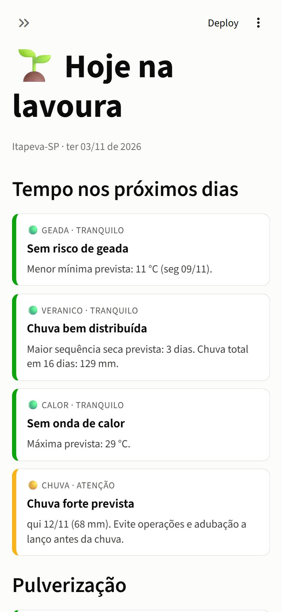
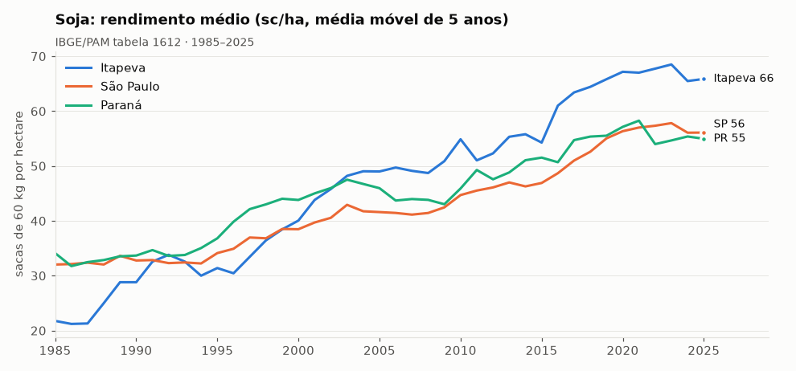
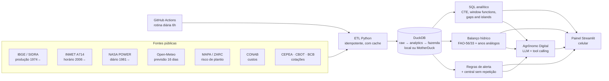

# 🌱 SafraViva Itapeva

**Inteligência agroclimática + gestão rural com IA para o produtor de grãos do Sudoeste Paulista.**

O SafraViva junta **52 anos de produção agrícola (IBGE)**, **45 anos de clima diário (NASA POWER + estação do INMET em Itapeva)**, o **zoneamento de risco climático (ZARC/MAPA)**, **custos de produção da CONAB** e a **previsão do tempo** para responder às perguntas do dia a dia de quem planta soja, milho e trigo em Itapeva-SP:

> *Posso pulverizar amanhã? Tem risco de geada para o trigo? Já é época de plantar soja nesse talhão arenoso? Quanto a lavoura deve render com essa seca? Quanto me custou cada saca?*



**O que ele faz**
- 🏠 **Hoje na lavoura:** alertas de geada, veranico, calor e chuva; a fase de cada talhão cruzada com o tempo; o melhor horário para pulverizar; a época de plantio.
- 🔔 **Central de alertas:** só avisa o que importa, sem repetir; o alerta some quando a situação passa.
- 🌾 **Estimativa de safra:** balanço hídrico FAO dia a dia + anos análogos desde 1991 → faixa provável de produtividade, **validada contra o IBGE**.
- 🤖 **Agrônomo Digital:** chat com IA que consulta os dados (14 ferramentas), cita a fonte, respeita os limites (receituário agronômico, não é conselho de investimento) e **lança no caderno de campo o que o produtor dita**, com confirmação.
- 📊 **Cotações ao vivo:** soja, milho, trigo e dólar. CEPEA (físico, histórico desde 1997), bolsa de Chicago convertida para R$/saca (~15 min de atraso) e dólar comercial/PTAX; sazonalidade, prêmio de porto e preço × custo por saca da fazenda. A tela se atualiza sozinha a cada 5 min e tem pergunta à IA ("subiu por Chicago ou pelo dólar?").
- 💰 **Gestão:** caderno de campo, custos, colheita e vendas; custo por saca, **ponto de equilíbrio** e margem por talhão; comparação com a CONAB e com a média de Itapeva.
- 📈 **Região:** Itapeva × SP × PR, safras boas e ruins com o clima de cada uma, geada por mês, aquecimento do verão.

Painel em Streamlit, pensado para o **celular** e para leitura **sob sol**.

<br clear="right">

## Destaques da análise

| | |
|---|---|
| **+17% / +30% / +17%** | produtividade de soja, milho e trigo de Itapeva acima da média de SP (média móvel de 5 anos) |
| **4 mil → 82 mil ha** | crescimento da soja em Itapeva entre 2000 e 2025 |
| **~3×** | mais dias com máxima ≥ 32 °C nos verões da década de 2020 |
| **−28% em 2024** | quebra da soja explicada por calor e seca no florescimento |
| **−5% por dia de geada** | no florescimento do trigo (modelo em painel com 11 municípios, p = 0,02) |
| **r = 0,32** | balanço hídrico × produtividade da soja (backtest 1991–2025), melhor que qualquer índice isolado |



Mais em [docs/insights.md](docs/insights.md) e no [notebook](notebooks/01_clima_e_producao_itapeva.ipynb).

## Arquitetura



| Camada | Tecnologia |
|---|---|
| Dados | Python, pandas, requests, DuckDB (local) / MotherDuck (nuvem) |
| Análise | SQL (CTEs, window functions, UNPIVOT, gaps and islands), statsmodels, matplotlib |
| Modelo | Balanço hídrico FAO-56 + FAO-33, cenários por anos análogos, backtest contra o IBGE |
| IA | OpenAI (Chat Completions + function calling), provedor isolado atrás de uma interface |
| Painel | Streamlit + Plotly, paleta validada para daltonismo, tema claro para o campo |
| Qualidade | 98 testes (pytest + AppTest do Streamlit), avaliação do agente com 12 perguntas reais, CI no GitHub Actions |

## Qualidade e validação
- **Testes:** `pytest` cobre os parsers do ETL, as transformações SQL, as regras de alerta, a gestão (rateio, ponto de equilíbrio), o balanço hídrico, a central de alertas, o agente (com um modelo simulado) e as telas (preenchendo e enviando formulários com o AppTest).
- **Agente:** [12 perguntas reais](docs/avaliacao_agente.md), com checagem de ferramentas usadas e de limites. A leitura das respostas achou e corrigiu causa inventada, custo parcial comparado com a CONAB e estoque invisível ([D020](docs/decisoes.md)).
- **Estimativa de safra:** [backtest](docs/backtest_balanco.md) contra o IBGE. A confiabilidade é mostrada por cultura, e o trigo não gera alerta de produtividade porque o modelo hídrico não o explica.
- **Dados:** problemas da fonte oficial são marcados, não escondidos (ex.: soja 2025 repetida de 2024 no IBGE) → [docs/fontes.md](docs/fontes.md).

## Como rodar (no computador)

```bash
python -m venv .venv
.venv\Scripts\activate                 # Windows
pip install -r requirements.txt
copy .env.example .env                 # coordenadas da fazenda e, se quiser a IA, OPENAI_API_KEY
python -m scripts.rodar_etl            # carga completa (~10 min na 1ª vez; depois usa cache)
python -m scripts.carregar_demo        # fazenda de demonstração (fictícia)
python -m streamlit run app/main.py    # painel; no celular, use o "Network URL" no mesmo Wi-Fi
```

<details>
<summary>Outros comandos</summary>

```bash
python -m scripts.validar_fontes       # testa as 9 fontes de dados
python -m scripts.rotina_diaria        # atualiza tudo (previsão, clima, estimativas, alertas; resumo às segundas)
python -m scripts.rodar_analises       # 12 consultas SQL → docs/analises_resultados.md
python -m scripts.gerar_notebook       # executa o notebook e salva os gráficos
python -m scripts.backtest_balanco     # valida a estimativa de safra contra o IBGE
python -m scripts.avaliar_agente       # avalia o Agrônomo Digital com 12 perguntas reais
python -m scripts.relatorio_uso        # uso do painel: dias por semana e funil (viu → clicou → agiu)
python -m scripts.publicar_motherduck  # envia o banco para a nuvem (painel online)
pytest
```
</details>

## Painel online
🔗 **https://safraviva-itapeva.streamlit.app** (protegido por senha: dados de uma fazenda real)

O painel roda no **Streamlit Community Cloud**, protegido por senha, com o banco no **MotherDuck**. Os dados são atualizados todo dia às 6h por um **GitHub Actions** ([rotina_diaria.yml](.github/workflows/rotina_diaria.yml)). O passo a passo está em [docs/publicacao.md](docs/publicacao.md). Nenhum dado da fazenda fica neste repositório.

## Estrutura

```
core/        configuração da região, cliente HTTP, conexão com o banco (local ou nuvem)
etl/         extratores: IBGE, INMET, NASA POWER, Open-Meteo, ZARC, CONAB, cotações (CEPEA, CBOT, BCB)
sql/         ddl/ (camadas), transform/ (analytics), analises/ (12 perguntas de negócio)
analytics/   modelo clima × produtividade, balanço hídrico, estilo dos gráficos
ai/          Agrônomo Digital: ferramentas, laço de tool calling, prompt, resumo semanal
app/         painel: main.py, paginas/, alertas.py e notificacoes.py (regras testáveis), gestao.py
scripts/     orquestração: ETL, rotina diária, demo, avaliações, publicação
docs/        insights, fontes, decisões (D001–D027), dicionário de dados, conhecimento regional, design (7 passos)
```

## Próximos passos
- **Alertas no WhatsApp** (o envio já fica separado por canal).
- **Formulário do produtor:** ficha simples no celular para trocar a fazenda de demonstração pelos dados reais.

## Documentação
[Insights](docs/insights.md) · [Fontes](docs/fontes.md) · [Decisões técnicas](docs/decisoes.md) · [Dicionário de dados](docs/dicionario_dados.md) · [Conhecimento regional](docs/conhecimento_regional.md) · [Publicação](docs/publicacao.md) · [Roteiro original](PROMPT_MESTRE.md)

---
Projeto de **Rafael Prado** · dados públicos de IBGE, INMET, NASA POWER, Open-Meteo (CC BY 4.0), MAPA/ZARC, CONAB, CEPEA/ESALQ (CC BY-NC 4.0) e Banco Central.
