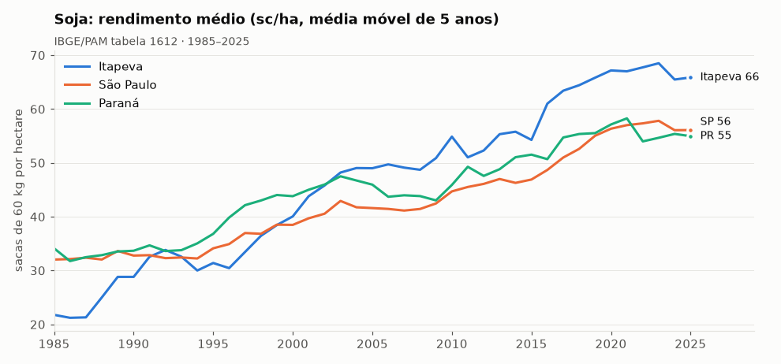
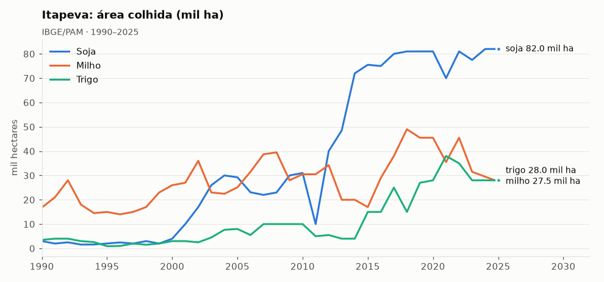
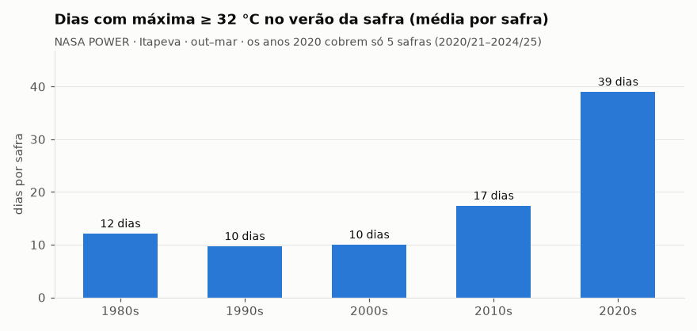
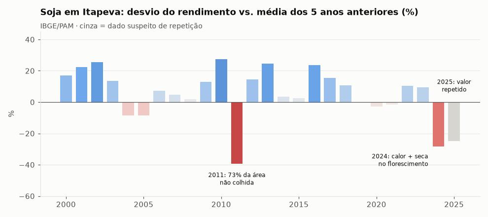
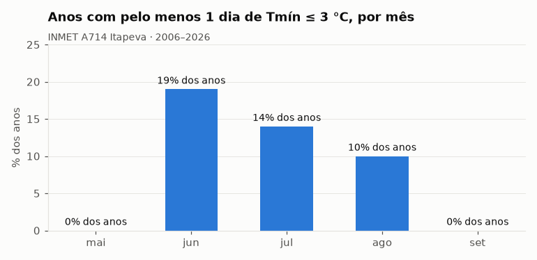
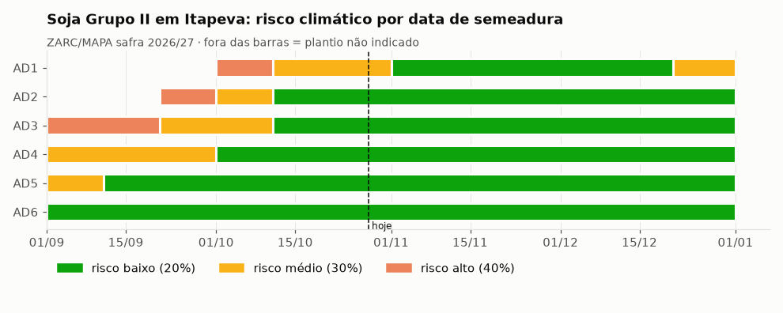
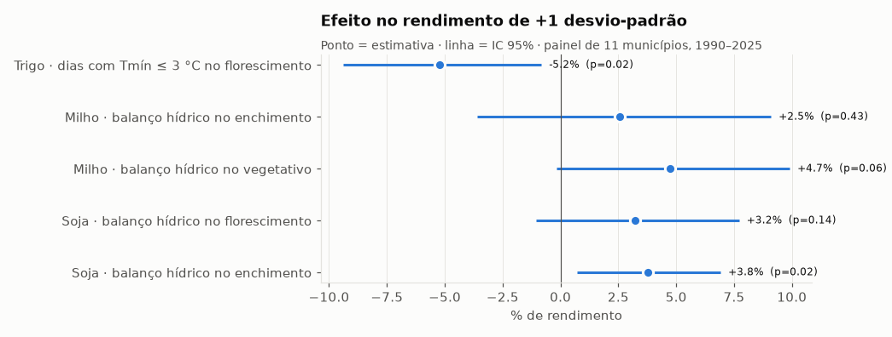

# Insights — Clima e produção em Itapeva (Fase 2)

Análise completa e gráficos: [notebooks/01_clima_e_producao_itapeva.ipynb](../notebooks/01_clima_e_producao_itapeva.ipynb) ·
tabelas: [analises_resultados.md](analises_resultados.md) · consultas: [`sql/analises/`](../sql/analises/).
Dados atualizados em 28/10/2026.

---

### 1. Itapeva produz mais por hectare que SP e PR, e a vantagem nasceu nos anos 2000
Média móvel de 5 anos, até 2025, comparada com SP: **soja 66 × 56 sc/ha (+17%)**, **milho 121 × 93 (+30%)** e **trigo 58 × 50 (+17%)**.
Em 1990, Itapeva ficava *abaixo* do estado nas três culturas (soja −12%, trigo −16%).

### 2. A soja multiplicou a área por 20 em 25 anos, e o trigo virou a cultura de inverno
- A soja foi de **4 mil para 82 mil ha (2000→2025, +12,8% ao ano)** e o trigo de **3 mil para 28 mil ha**.
- Itapeva concentra **31% da soja, 28% do milho e 33% do trigo** dos 11 municípios da região (média 2021–25).
- Na região, quem mais cresceu foi **Buri**: +19,5% ao ano na soja e +18,3% ao ano no trigo.

### 3. O verão está mais quente e seco na década de 2020
Pela série NASA POWER de Itapeva, no período de outubro a março:
- **Dias com máxima ≥ 32 °C:** cerca de 39 por safra nos anos 2020, contra 10 a 17 nas décadas anteriores.
- **Chuva:** 711 mm, contra 900 a 1.030 mm nas décadas anteriores.

A amostra ainda é curta (5 safras, incluindo o El Niño de 2023/24), mas a direção é consistente. O florescimento da soja em janeiro é a fase mais exposta.

### 4. A quebra da soja em 2024 tem assinatura climática; a de 2011, não
- **2024 (−28% vs. média de 5 anos):** o florescimento teve **13 dias ≥ 32 °C** e balanço hídrico de **−45 mm**.
- **2011:** 73% da área plantada não foi colhida, e o milho caiu 67%, mas a estação A714 mostra chuva normal ou acima do normal. A causa **não foi identificada** nos dados públicos; vale confirmar com a CATI e com produtores.
- **Trigo:**
  - geada no florescimento em 1994 e 2000 (Tmín de −1,7 °C e −1,5 °C);
  - seca no florescimento em 2019 (veranico de 33 dias);
  - **285 mm de chuva na colheita** em 2009.

### 5. A geada se concentra em junho e julho, justamente no trigo
- Na A714 (2006–2026), **19% dos anos** têm pelo menos um dia com Tmín ≤ 3 °C em junho e **14%** em julho.
- A mínima absoluta foi de **0,1 °C (julho/2021)**.
- No modelo em painel, **cada 1,2 dia a mais com Tmín ≤ 3 °C no florescimento do trigo reduz o rendimento em ~5% (p = 0,02)**.

A NASA POWER é **~0,8 °C mais fria que a estação no inverno**, então usá-la sem calibrar superestimaria a geada.

### 6. A janela de plantio da soja depende do solo
ZARC 2026/27, Grupo II, sequeiro:
- **Solos de boa retenção (AD4–AD6):** risco baixo de **1/out a 31/dez**.
- **Solo arenoso (AD1):** em outubro o risco ainda é médio ou alto, e o risco baixo só começa em **1/nov**.

Para colocar milho safrinha depois da soja, ela precisa ser precoce e semeada em outubro. O milho safrinha tem risco baixo até ~20/jan em AD4 e é praticamente inviável em AD1.

### 7. Prever sacas/ha só com o clima municipal não funciona, e o valor está nos alertas
Modelo em painel com 11 municípios, 1990–2025: log(rendimento) ~ município + tendência + índices por fase. Os erros são agrupados por ano e a validação é temporal.

| Cultura | Ganho tecnológico | R² sem → com clima | Erro fora da amostra (base → com clima) |
|---|---|---|---|
| Soja | +2,3% a.a. | 0,52 → 0,54 | 16,3% → 16,3% |
| Milho | +3,2% a.a. | 0,64 → 0,65 | 29,4% → 29,2% |
| Trigo | +2,5% a.a. | 0,45 → 0,47 | 25,8% → 24,9% |

- Os efeitos têm a direção esperada: água no enchimento da soja dá **+3,8% por desvio-padrão** (p = 0,02), e a geada no florescimento do trigo dá **−5,2%** (p = 0,02).
- Mesmo assim, o ganho preditivo é marginal. Com 5 índices por cultura, o modelo **perdia** para a base, um caso clássico de sobreajuste. A versão final usa 1 ou 2 índices.
- **Por quê:**
  - a PAM municipal é ruidosa;
  - as fases fenológicas são aproximadas por calendário;
  - o clima de um ano atinge todos os municípios ao mesmo tempo, então há ~35 "experimentos", não 350.

**Decisão de produto:**
- **Fase 6:** o clima vira **alerta e risco** (geada no florescimento do trigo, veranico e calor na soja, janelas de plantio e pulverização).
- **Estimativa de safra:** vai usar um **balanço hídrico da cultura (FAO-33, Ky)** com a previsão diária, em vez de só regressão.

### 8. O dado oficial tem falhas e o projeto as trata explicitamente
- **Valores repetidos:** a PAM 2025 repete os valores de 2024 em Itapeva, Guapiara, Nova Campina e Ribeirão Branco. Esses registros recebem o flag `suspeito_repeticao` e ficam fora das médias e do modelo.
- **Calibração da NASA:** a chuva diária da NASA concorda pouco com a A714 (r ≈ 0,5–0,8 conforme o mês), mas o total fica correto (razão ≈ 1). Por isso a NASA serve para acumulados e para municípios sem estação; para Itapeva, o projeto usa a A714 e só preenche as falhas com a NASA calibrada.

---

## Limitações
- O calendário fenológico é regional e aproximado (`analytics.dim_fase_fenologica`), não a data real de cada lavoura.
- O milho da PAM soma 1ª e 2ª safra; o modelo de milho assume as fases do milho verão.
- A série de 2020 em diante é curta para afirmar tendência; o insight 3 é um sinal a acompanhar, não uma conclusão.
